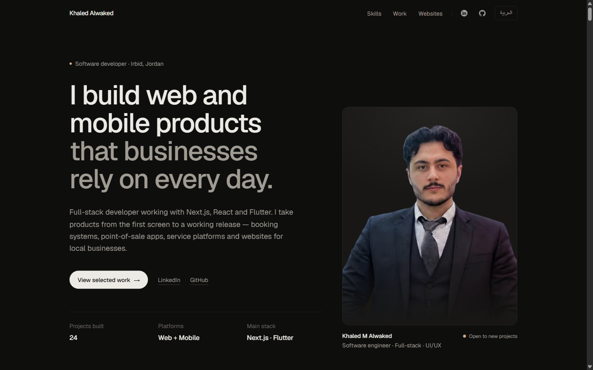
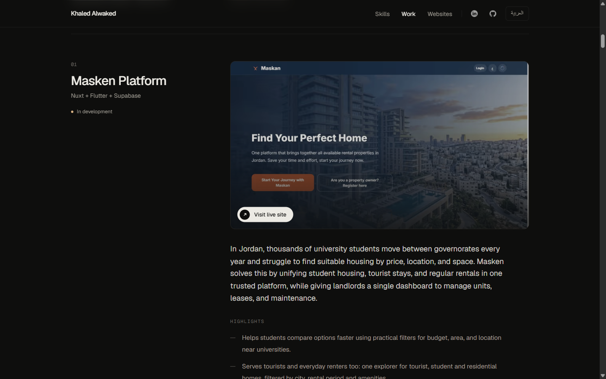
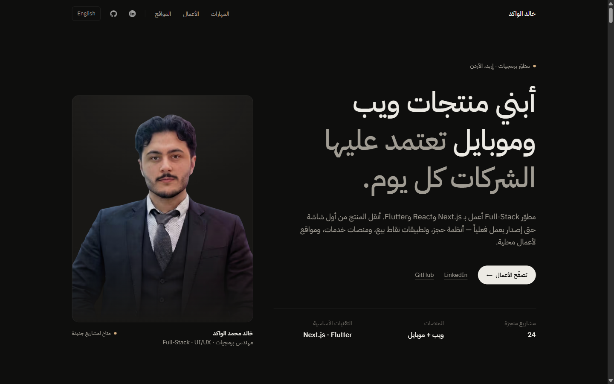

# Khaled Alwaked — Portfolio

Personal portfolio of **Khaled M Alwaked**, a full-stack developer in Irbid, Jordan, building web and mobile products with Next.js, React, Vue and Flutter.

The site is bilingual (English and Arabic, with full RTL support) and presents product case studies and websites built for businesses in Jordan and Saudi Arabia.



<table>
  <tr>
    <td></td>
    <td></td>
  </tr>
</table>

## What's inside

| Section | Content |
|---|---|
| **Selected work** | Product case studies: the problem, what was built and what changed. Includes Masken, Chaty, V-Safety Manager, Challenger, Task Flow and Flutter apps, with demo videos or live links |
| **Websites — Jordan** | Redesign and new-site proposals for local restaurants and clinics, each live and bilingual |
| **Websites — Saudi Arabia** | Twelve rebuilds for businesses whose websites had stopped working |

## Stack

- **Next.js 16** (App Router) and **React 19**
- **Tailwind CSS** for styling
- **TypeScript**
- `next/font` with Geist and IBM Plex Sans Arabic
- **Vercel Speed Insights**

## Getting started

```bash
npm install
npm run dev      # http://localhost:3000
```

| Script | Purpose |
|---|---|
| `npm run dev` | Start the development server (Turbopack) |
| `npm run build` | Create the production build |
| `npm run start` | Serve the production build |
| `npm run lint` | Run ESLint |

## Project structure

```
app/
  layout.tsx          fonts, metadata, Speed Insights
  page.tsx            all page content (English + Arabic) and sections
  globals.css         theme tokens and base styles
components/
  project-list.tsx    numbered case-study list with video and live-site previews
assest/               portrait and social icons
public/projects/      screenshots used for live-site previews
```

### Adding a project

Add an entry to `projectCardsByLocale` (or one of the website lists) in `app/page.tsx`, in both `en` and `ar`. A card can show a YouTube demo (`youtubeUrl`) or a live-site preview (`site: { url, image }`, with the screenshot saved in `public/projects/`).

## Contact

- [LinkedIn](https://www.linkedin.com/in/khaled-alwaked)
- [GitHub](https://github.com/engKhaledalwaked)
